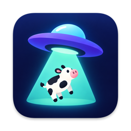
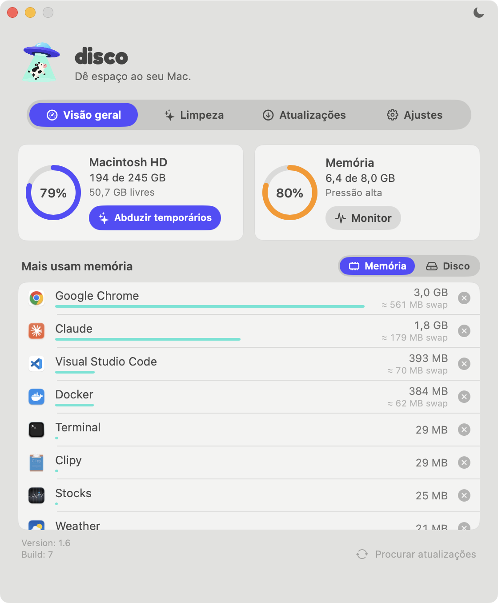
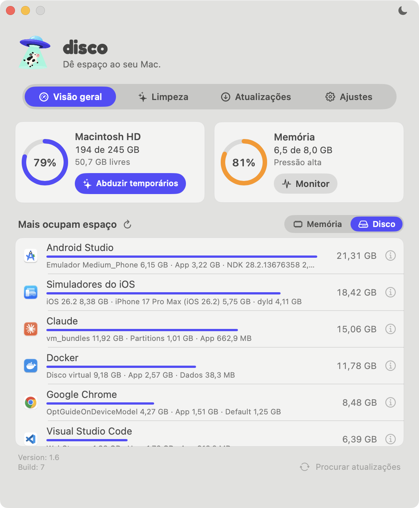
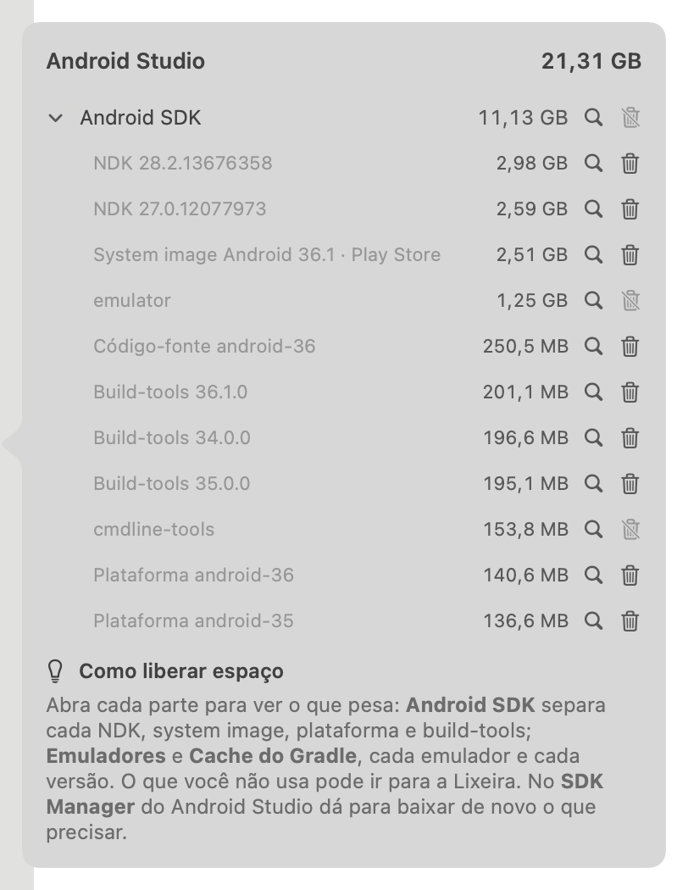
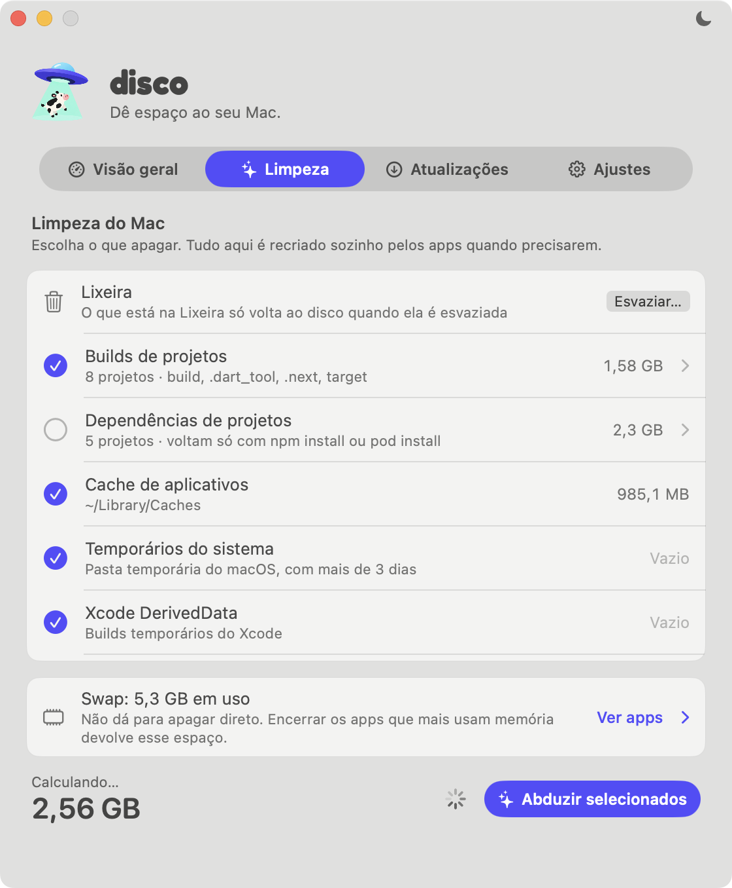
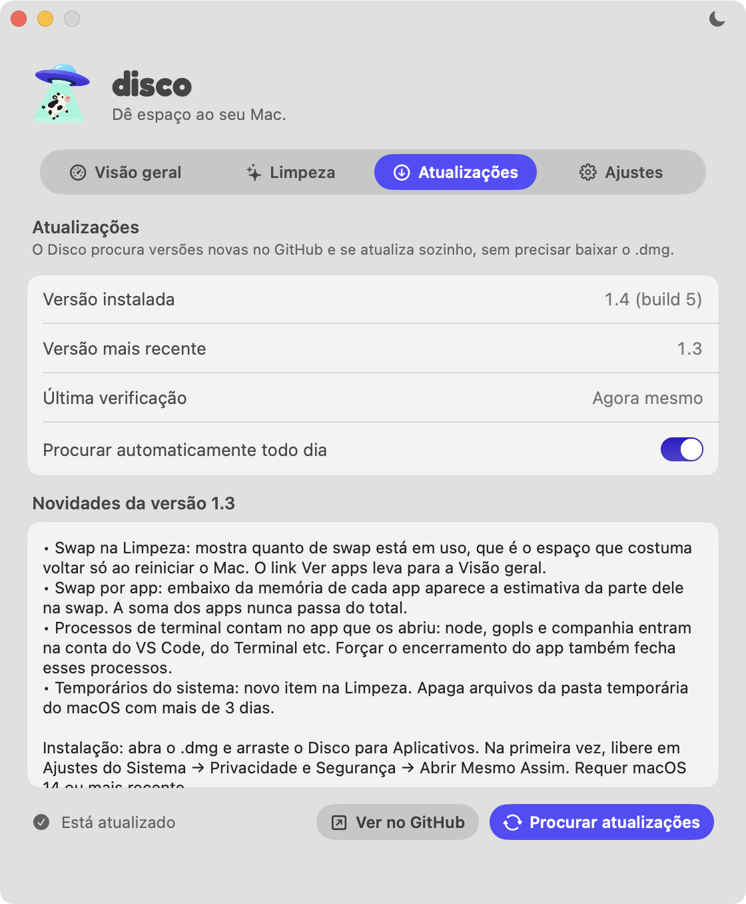
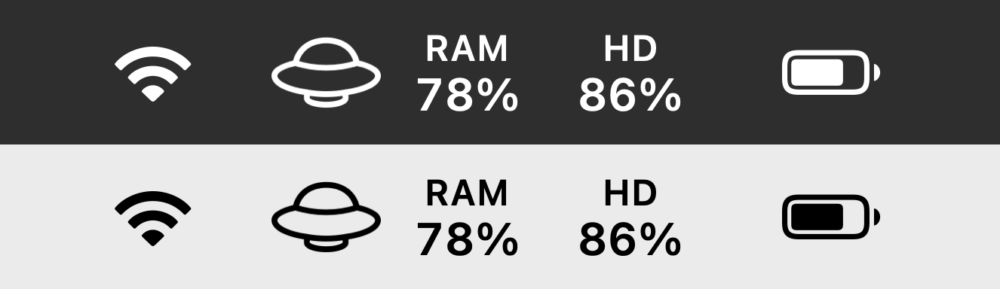
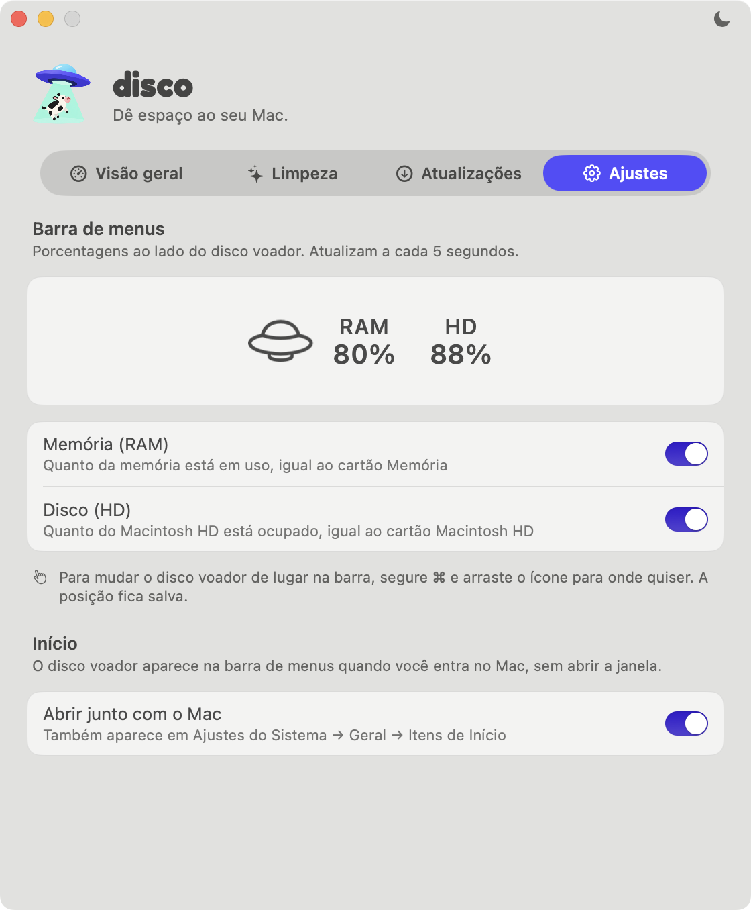
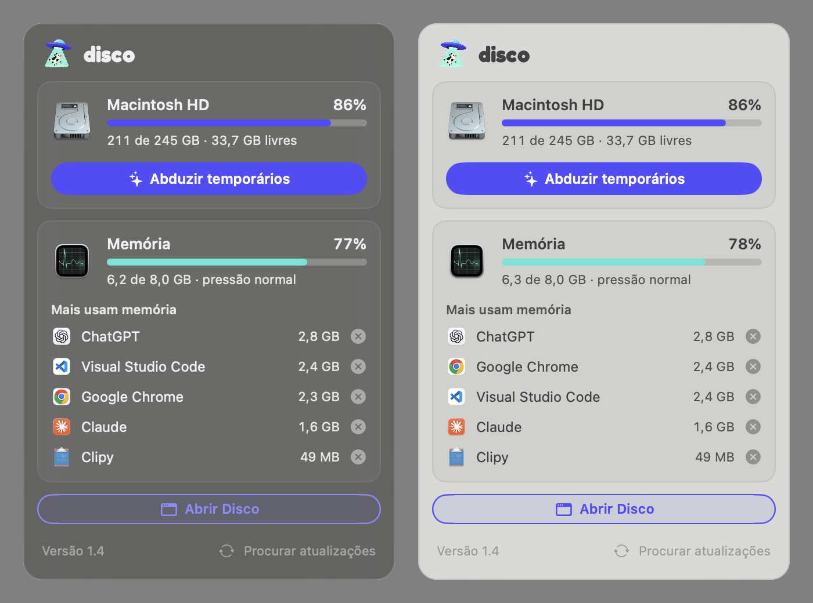
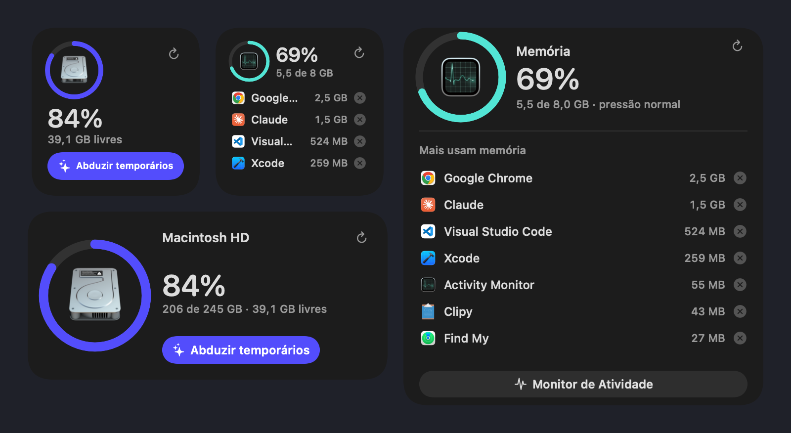

<p align="center">
  
</p>

<p align="center">
  <picture>
    <source media="(prefers-color-scheme: dark)" srcset="brand/logo-disco-branco.svg">
    
  </picture>
  <br><br>
  <picture>
    <source media="(prefers-color-scheme: dark)" srcset="brand/slogan-branco.svg">
    
  </picture>
</p>

<p align="center">
  Disco e memória do Mac na barra de menus, em widgets e numa janela no estilo do macOS.<br>
  Abduza os arquivos temporários e force o encerramento de apps pesados em um clique.
</p>

<p align="center">
  <a href="https://github.com/RogerBrusamarello/disco-macos/releases/latest"><b>⬇︎ Baixar Disco.dmg</b></a>
  &nbsp;·&nbsp; versão 1.8 &nbsp;·&nbsp; macOS 14 ou mais recente &nbsp;·&nbsp; Apple Silicon
</p>

---

## O que o disco faz

- **Mostra o uso do disco e da memória ao vivo**, na barra de menus (com a % de RAM e de HD e a temperatura da CPU ao lado do disco voador, se você quiser), nos widgets e na janela.
- **Mostra a temperatura do Mac:** a da CPU (o núcleo mais quente do chip) e a da bateria, em °C, com um aviso quando o macOS começa a esquentar ou a reduzir o desempenho. Lê os sensores direto do chip, sem pedir senha.
- **Lista os apps que mais usam memória**, somando os processos auxiliares de cada um (Chrome, apps em Electron…) e o que foi aberto no terminal dele (`node`, `gopls`… contam no VS Code ou no Terminal), com quanto de cada app está na swap e um **ⓧ para forçar o encerramento**.
- **Mostra o que mais ocupa o disco:** qualquer app e as ferramentas de desenvolvimento (Docker, simuladores do iOS, Android Studio e Gradle, Homebrew…), com o que tem dentro de cada um. O que dá para apagar com segurança vai para a Lixeira com um clique; o que o app precisa fica com a lixeira riscada e o motivo.
- **Abduz temporários:** você escolhe o que apagar entre os builds e as dependências dos seus projetos (Flutter, Node, Next.js, Rust, CocoaPods), caches, temporários do sistema, builds do Xcode, Gradle, Go, simuladores, pacotes e logs antigos, e vê o tamanho de cada item antes. Também mostra quanto está parado na Lixeira, com o botão para esvaziar.
- **Respeita o visual do macOS:** modo claro e escuro, fonte do sistema, vidro translúcido e cores flat na paleta da marca.
- **Se atualiza sozinho:** procura versões novas no GitHub uma vez por dia e, com um clique, baixa, instala e reabre.
- **Fica leve:** sem ícone no Dock, abre junto com o Mac (dá para desligar na aba Ajustes) e só atualiza com frequência quando você está olhando.

## Janela

<p align="center">
  <picture>
    <source media="(prefers-color-scheme: dark)" srcset="docs/readme/aba-visao-geral-memoria-escuro.png">
    
  </picture>
</p>

Abre pelo Spotlight (`⌘ Espaço` → *Disco*), pelo Finder, clicando num widget ou em **Abrir Disco** na barra de menus.

- **Visão geral:** cartões do **Macintosh HD** e da **Memória**, a linha da **temperatura** (CPU, bateria e o estado térmico: normal, aquecendo, quente ou muito quente) e uma lista rolável que alterna, pela chave **Memória | Disco** ao lado do título, entre **Mais usam memória** (até 10 apps) e **Mais ocupam espaço** (veja [Mais ocupam espaço](#mais-ocupam-espaço)). Embaixo da memória de cada app aparece a estimativa da parte dele na swap (a partir de 50 MB). Cada app tem um ⓧ sempre visível, com a dica *Forçar encerrar*, e uma confirmação antes de fechar; encerrar também fecha os processos abertos no terminal do app.
- **Limpeza:** a lista do que pode ser abduzido (veja abaixo).
- **Atualizações:** a versão instalada, a mais recente no GitHub e as novidades (veja abaixo).
- **Ajustes:** o que aparece ao lado do disco voador na barra de menus (veja [Barra de menus](#barra-de-menus)), a dica de como mudar o disco voador de lugar na barra e a chave **Abrir junto com o Mac** (veja [Abrir junto com o Mac](#abrir-junto-com-o-mac)).
- **Tema:** o botão ☀︎/☾ no canto superior direito alterna a janela entre claro e escuro, e a escolha fica salva.
- **Rodapé:** versão e build instaladas e o link **Procurar atualizações**, que vira o botão **Atualizar para X** quando sai uma versão nova.
- Enquanto a janela está aberta, o disco aparece no Dock e no `⌘ Tab`. Ao fechar, volta a ficar só na barra de menus.

## Mais ocupam espaço

<p align="center">
  <picture>
    <source media="(prefers-color-scheme: dark)" srcset="docs/readme/aba-visao-geral-disco-escuro.png">
    
  </picture>
</p>

Na Visão geral, a chave **Disco** troca a lista de memória pelo que mais ocupa o Macintosh HD: até 12 apps e ferramentas, do maior para o menor, a partir de 100 MB. Cada linha mostra o total, uma barra e as três maiores coisas de dentro (por exemplo, *Emulador Medium_Phone 6,2 GB · App 3,2 GB · NDK 28.2 3 GB*).

### Detalhe: o que tem dentro e o que dá para apagar

<p align="center">
  <picture>
    <source media="(prefers-color-scheme: dark)" srcset="docs/readme/detalhe-espaco-escuro.png">
    
  </picture>
</p>

Clicando numa linha, abre o detalhe com as partes do item (o app, os dados, o cache, o SDK…). Clicando no nome de uma parte, ela se abre no que tem dentro, do maior para o menor: cada versão do NDK, cada emulador, cada simulador, cada pasta de dados de um app. Toda linha tem:

- **Lupa:** mostra a pasta no Finder.
- **Lixeira ativa:** dá para apagar. A dica (passando o mouse) diz o que acontece. Antes de apagar aparece uma confirmação com o tamanho.
- **Lixeira riscada:** não dá para apagar pelo disco, e a dica diz por quê: é importante para o app funcionar, faz parte do macOS, não há permissão, ou a ferramenta tem o próprio jeito de apagar (`brew uninstall`, `ollama rm`, `docker system prune`…).

O que é apagado pela lixeira **vai para a Lixeira do Mac**: dá para recuperar, e o espaço só volta ao disco quando você esvazia a Lixeira. O resultado aparece ao lado do título da lista (*✓ X na Lixeira*); clicando nele, abre a aba Limpeza, que mostra quanto está na Lixeira e tem o botão **Esvaziar…** (veja [Lixeira](#lixeira)). Simuladores e runtimes do iOS são a exceção: saem de vez pelo `xcrun simctl`, que é o jeito que o Xcode aceita. Se o app do item estiver aberto, o disco pede para fechar antes.

A mesma regra vale para qualquer app de Aplicativos (Word, Excel, Photoshop, Chrome…):

| Parte | Lixeira |
|---|---|
| **App** | ativa: move o app para a Lixeira, o que desinstala. Riscada nos apps do macOS (Safari, por exemplo) |
| **Dados** (`~/Library/Application Support/<app>`) | dentro dela, ativa só no que é cache, logs ou relatórios de falha, que o app recria. O resto (configurações, contas, arquivos, modelos) fica riscado: quem limpa é o próprio app |
| **Cache** (`~/Library/Caches/<app>`) | ativa: o app recria sozinho |

Nas ferramentas de desenvolvimento, o detalhe separa o que dá para apagar com segurança:

| Item | Ativa | Riscada |
|---|---|---|
| **Simuladores do iOS** | cada runtime (iOS 26.2…) e cada simulador (iPhone 17 Pro Max…), pelo `simctl` | runtimes que o macOS não deixa apagar, caches do sistema |
| **Xcode** | cada versão em DeviceSupport, cada data em Archives, cada projeto em DerivedData | — |
| **Android Studio** | cada NDK, system image, plataforma, build-tools, código-fonte e CMake; cada emulador (com o `.ini` dele); cada versão no cache do Gradle; configurações de versões antigas do Android Studio | `emulator`, `platform-tools` e o que o Android Studio precisa para rodar; configurações da versão atual |
| **Node, Rust, Python** | cada versão do nvm, cada toolchain do rustup, cada versão do pyenv, os caches de pacotes | programas instalados (`bin`), conda |
| **Docker, Homebrew, Go, Ollama, Backups do iPhone** | downloads do Homebrew e cache de build do Go | disco virtual do Docker, pacotes do Homebrew, módulos do Go, modelos do Ollama e backups, que têm comando ou tela própria |

### Liberar com um clique

Em dois itens, o detalhe também tem um botão que apaga tudo de uma vez, **de vez** (sem passar pela Lixeira), depois de uma confirmação. O resultado aparece ao lado do título da lista (*✓ X liberados*, o tamanho medido antes de apagar).

| Botão | O que faz | Efeito colateral |
|---|---|---|
| **Apagar runtimes antigos** (Simuladores do iOS) | apaga os runtimes dos simuladores, menos a versão mais nova de cada plataforma (iOS, watchOS, tvOS, visionOS), com `xcrun simctl runtime delete`, e depois os simuladores que ficaram sem runtime. Só aparece quando há versões antigas | Para testar numa versão apagada, baixe de novo no Xcode, em **Settings → Components** |
| **Apagar o cache do Gradle** (Android Studio) | encerra os daemons do Gradle e apaga o conteúdo de `~/.gradle/caches`. Com o Android Studio aberto, pede para fechar antes | O próximo build de cada projeto baixa as dependências de novo e demora mais |

| Linha | O que soma |
|---|---|
| **Simuladores do iOS** | cada runtime do iOS (watchOS, tvOS, visionOS) instalado, os simuladores e os caches |
| **Xcode** | o app, DeviceSupport, Archives e DerivedData |
| **Android Studio** | o app, o Android SDK, os emuladores, o cache do Gradle (`~/.gradle/caches`), o resto do Gradle e os dados do app. Sem o app, a linha se chama *Android e Gradle* |
| **Docker** | o app, o disco virtual (só o que está gravado nele) e os dados. Com o Docker aberto, o detalhe diz quanto o `docker system df` calcula que dá para liberar |
| **Homebrew, Node.js, Rust, Go, Python** | pacotes, versões instaladas e caches de cada um |
| **Ollama, LM Studio** | o app e os modelos baixados |
| **Caches de ferramentas** | as pastas de `~/.cache` |
| **Backups do iPhone** | `~/Library/Application Support/MobileSync/Backup` |
| **Outros apps** | cada app de Aplicativos, os dados dele em `~/Library/Application Support` e o cache, com cada pasta de dentro separada |

- A medição roda em segundo plano e leva de segundos a um minuto. Ela acontece na primeira vez que a lista aparece e de novo se já faz mais de 30 minutos. O ↻ ao lado do título mede na hora, e passando o mouse em cima aparece quando foi a última medição.
- Para não pedir permissões, esta lista não entra em Mesa, Documentos, Downloads, Lixeira, nem nas pastas de dados de outros apps em `~/Library/Containers` (do Docker, lê só o arquivo do disco virtual). Os dados dos apps da Apple também ficam de fora: conta só o tamanho do app. Os projetos da Mesa e de Documentos aparecem na aba Limpeza (veja [Projetos](#projetos)).

## Abduzir temporários

<p align="center">
  <picture>
    <source media="(prefers-color-scheme: dark)" srcset="docs/readme/aba-limpeza-projetos-escuro.png">
    
  </picture>
</p>

O botão **Abduzir temporários** tem o mesmo visual no widget, na barra de menus e na janela, e sempre leva para a aba **Limpeza**. Lá você marca o que quer apagar, vê o total e clica em **Abduzir selecionados**. No final aparece quanto espaço foi liberado.

| Item | O que apaga | Efeito colateral |
|---|---|---|
| **Lixeira** | botão **Esvaziar…**, fora da seleção (veja [Lixeira](#lixeira)) | Apaga de vez: não dá para recuperar. |
| **Builds de projetos** | `build` e `.dart_tool` (Flutter), `.next` (Next.js), `target` (Rust) e os `Pods` de apps Flutter, projeto por projeto (veja [Projetos](#projetos)) | O próximo build compila do zero e demora mais. |
| **Dependências de projetos** *(desmarcado)* | `node_modules` e os `Pods` de apps iOS nativos | O projeto só volta a rodar depois do `npm install` (ou `yarn`, `pnpm install`) ou do `pod install`. |
| **Cache de aplicativos** | `~/Library/Caches`, menos `go-build`, que tem item próprio | Os apps recriam o cache sozinhos. A primeira abertura pode ficar um pouco mais lenta. |
| **Temporários do sistema** | arquivos da pasta temporária do macOS (`$TMPDIR`, em `/var/folders/…/T`) com mais de 3 dias | Nenhum no uso normal: os apps abertos usam os arquivos recentes, que ficam. |
| **Xcode DerivedData** | `~/Library/Developer/Xcode/DerivedData` | O próximo build compila tudo do zero. |
| **Caches de simuladores** | `~/Library/Developer/CoreSimulator/Caches` e simuladores de versões do iOS que não estão mais instaladas | Os simuladores abrem um pouco mais devagar na primeira vez. |
| **Cache do Gradle** | `~/.gradle/caches`. Com o Gradle rodando (um `GradleDaemon` aberto pelo Android Studio ou por um build), a linha fica bloqueada e o disco não apaga | O próximo build de cada projeto baixa as dependências de novo e demora mais. |
| **Cache de build do Go** | `~/Library/Caches/go-build` | O próximo `go build` compila do zero. |
| **Instaladores de extensões** | `CachedExtensionVSIXs` do VS Code e do Cursor, em `~/Library/Application Support` | Nenhum: são cópias dos instaladores das extensões que já estão instaladas. |
| **npm / Yarn / pnpm** | `~/.npm/_cacache`, `~/.yarn/berry/cache`, `~/Library/pnpm/store` | O próximo `install` baixa os pacotes de novo. |
| **Logs antigos** | arquivos de `~/Library/Logs` com mais de 7 dias | Nenhum no uso normal. |
| **Dados dos simuladores** *(desmarcado)* | fecha os simuladores e zera todos com `xcrun simctl erase all`. O tamanho é a soma das pastas `data` de cada simulador | Apaga os apps instalados nos simuladores e os arquivos deles. Os simuladores continuam na lista do Xcode. |
| **Cache dyld dos simuladores** | botão **Apagar…**, fora da seleção (veja [Cache dyld dos simuladores](#cache-dyld-dos-simuladores)) | O próximo simulador que abrir recria o cache e demora mais nessa vez. |

Não mexe em documentos, fotos, código dos projetos, configurações nem arquivos do sistema. Os itens marcados como *desmarcado* começam fora da seleção porque têm efeito colateral: marque se quiser. Uma linha bloqueada (⊘) mostra o motivo no lugar da descrição.

### Projetos

O disco procura projetos em `~/Desktop` (Mesa), `~/Documents` e `~/Developer`, até 8 níveis abaixo de cada uma. **Pastas…**, embaixo da lista de projetos aberta, muda onde procurar: tira, põe outras pastas ou volta ao padrão. Na primeira procura, o macOS pede permissão para o disco ler a Mesa e Documentos; sem ela, a lista diz qual pasta ficou de fora e onde liberar (Ajustes do Sistema → Privacidade e Segurança → Arquivos e Pastas).

Uma pasta só entra com o marcador do projeto ao lado:

| Pasta | Marcador | Item |
|---|---|---|
| `build`, `.dart_tool` | `pubspec.yaml` | Builds |
| `ios/Pods`, `macos/Pods` | `pubspec.yaml`, com o `Podfile` ao lado dos `Pods` | Builds (o `flutter run` reinstala) |
| `.next` | `package.json` | Builds |
| `target` | `Cargo.toml` | Builds |
| `node_modules` | `package.json` | Dependências |
| `Pods` | `Podfile` | Dependências |

- **Sempre fica:** pasta sem marcador (um `build/` sem `pubspec.yaml` pode ser código-fonte ou guardar arquivos de release, como o `build/release` deste projeto), tudo dentro de um SDK (pasta com `bin/flutter`, `bin/cache/dart-sdk`, `platform-tools` ou `build-tools`, como `~/Documents/flutter`), tudo dentro de `node_modules`, pastas ocultas, atalhos e pacotes (`.app`, `.xcodeproj`…).
- **Em uso:** se algum processo está com a pasta atual (cwd) dentro do projeto, como um terminal, um servidor ou um script `node`, o projeto aparece bloqueado e fica de fora. O disco confere de novo na hora de apagar, e o resultado diz quantos projetos ficaram.
- **Escolher:** clicando no grupo, abre a lista por projeto, com o que sai, o tamanho e quando foi usado (a última modificação). Dá para marcar projeto por projeto; o ✓ do grupo marca ou desmarca todos. Clique com o botão direito num projeto para mostrar as pastas no Finder.
- **Apagar:** as pastas saem de vez (não vão para a Lixeira). Antes de apagar cada uma, o disco confere de novo se o marcador continua ao lado.

### Lixeira

O que vai para a Lixeira (pela lixeira de [Mais ocupam espaço](#mais-ocupam-espaço) ou pelo Finder) continua ocupando o disco até ela ser esvaziada. A primeira linha da Limpeza mostra quanto está parado lá:

- **Com Acesso Total ao Disco** (Ajustes do Sistema → Privacidade e Segurança), o disco mede a Lixeira inteira.
- **Sem ele**, o macOS não deixa listar a Lixeira. O disco mede o que ele mesmo mandou para lá, que ele guarda ao mover cada item. O que você apagou pelo Finder não entra na conta.

**Esvaziar…** pede confirmação e então pede ao Finder para esvaziar a Lixeira inteira, de vez. Na primeira vez, o macOS pergunta se o disco pode controlar o Finder. Se a permissão for negada, o disco apaga só o que ele mesmo mandou para a Lixeira e avisa; para dar a permissão depois: Ajustes do Sistema → Privacidade e Segurança → Automação → Disco → Finder.

### Cache dyld dos simuladores

`/Library/Developer/CoreSimulator/Caches/dyld` (alguns GB) é o cache das bibliotecas do sistema que os simuladores do iOS montam, e pertence ao root. Quando existe, aparece no fim da lista com o tamanho e o botão **Apagar…**, fora da seleção: depois da confirmação, o disco fecha os simuladores e o macOS pede a senha de administrador. Dá para fazer o mesmo no Terminal (a dica da linha mostra o comando):

```bash
sudo rm -rf /Library/Developer/CoreSimulator/Caches/dyld
```

### Swap

Abaixo da lista aparece quanto de **swap** está em uso: a memória que o macOS gravou no disco porque a RAM encheu. É por isso que reiniciar o Mac costuma liberar vários GB que a limpeza não libera. A swap não pode ser apagada direto (os arquivos são do sistema); ela diminui quando os apps que ocupam a memória são encerrados. **Ver apps** leva para a Visão geral, onde cada app mostra a parte dele na swap.

A parte de cada app é uma estimativa: o macOS informa quanto de cada processo foi comprimido, e o disco reparte a swap real por essa proporção, então a soma dos apps nunca passa do total.

## Atualizações

<p align="center">
  <picture>
    <source media="(prefers-color-scheme: dark)" srcset="docs/readme/aba-atualizacoes-escuro.png">
    
  </picture>
</p>

O disco procura versões novas nos [releases do GitHub](https://github.com/RogerBrusamarello/disco-macos/releases) uma vez por dia. Quando acha, o botão **Atualizar para X** aparece no painel da barra de menus, no rodapé da Visão geral e na aba **Atualizações**.

- **Aba Atualizações:** versão instalada, versão mais recente, quando foi a última verificação, a opção **Procurar automaticamente todo dia** e as novidades da versão. **Procurar atualizações** busca na hora, e **Ver no GitHub** abre a página do release.
- **Atualizar:** aparece um aviso com as novidades. Em **Atualizar e Reabrir**, o disco baixa o `.dmg`, confere se o arquivo é o mesmo publicado no GitHub (sha256) e se o app foi assinado pelo mesmo desenvolvedor, troca a versão instalada e abre de novo, já com o widget novo.
- **Sem o bloqueio do Gatekeeper:** a versão baixada pelo próprio disco não ganha a marca de quarentena, então não precisa liberar de novo em Privacidade e Segurança.
- Se o disco não tiver permissão para trocar o app (usuário sem administrador, por exemplo), ele abre o download do `.dmg` no navegador.

A atualização automática vale a partir da versão 1.4. Quem está na 1.3 ou antes atualiza uma última vez à mão.

## Barra de menus

<p align="center">
  
</p>

Na barra de menus fica o **disco voador em contorno**, no mesmo traço dos ícones do sistema. Ao lado dele podem aparecer até três blocos, com o nome em cima e o valor embaixo:

- **RAM:** quanto da memória está em uso (o mesmo número do cartão Memória). Vem ligado.
- **HD:** quanto do Macintosh HD está ocupado (o mesmo número do cartão Macintosh HD). Vem desligado.
- **CPU:** a temperatura do núcleo mais quente do chip, em graus (ex.: 52°). Vem desligado. A dica do ícone também mostra a temperatura.

Cada bloco liga e desliga na aba **Ajustes** da janela, que mostra uma prévia de como fica a barra. Os números atualizam a cada 5 segundos, e o bloco tem largura fixa, então o ícone não pula quando a porcentagem muda. Com todos desligados, fica só o disco voador.

<p align="center">
  <picture>
    <source media="(prefers-color-scheme: dark)" srcset="docs/readme/aba-ajustes-inicio-escuro.png">
    
  </picture>
</p>

**Mudar de lugar na barra:** segure `⌘` e arraste o disco voador para onde quiser, por exemplo para perto do relógio. Vale para qualquer ícone da barra de menus, e o macOS guarda a posição. A aba **Ajustes** mostra essa dica embaixo das chaves.

Deixando o mouse em cima do ícone, aparecem a memória e o espaço livre. Clicando, abre o painel:

<p align="center">
  
</p>

- Segue o estilo da **Central de Controle**: vidro translúcido, cantos arredondados, sem setinha e com o conteúdo em módulos.
- **Módulo Disco:** a barra de uso e o botão **Abduzir temporários**.
- **Módulo Memória:** a barra colorida pela pressão de memória e os 5 apps que mais usam memória, cada um com ⓧ.
- **Abrir Disco** abre a janela.
- **Rodapé:** a versão instalada e **Procurar atualizações**, que vira **Atualizar para X** quando tem versão nova.
- Os números atualizam a cada 2 segundos enquanto o painel está aberto. Um clique fora fecha o painel.

## Abrir junto com o Mac

Na aba **Ajustes**, a seção **Início** tem a chave **Abrir junto com o Mac**. Vem ligada: quando você entra no Mac, o disco voador aparece na barra de menus, sem abrir a janela. Desligando, o disco só abre quando você abrir pelo Spotlight, pelo Finder ou por um widget.

- A escolha fica salva e vale também depois de atualizar o app.
- A chave usa o mesmo registro dos **Ajustes do Sistema → Geral → Itens de Início**. Se o disco for desligado por lá, a chave avisa *Falta permitir em Ajustes do Sistema → Geral → Itens de Início* e mostra o botão **Abrir Itens de Início**. A aba confere de novo quando você volta para o disco.

## Widgets

<p align="center">
  
</p>

| Widget | Tamanho | O que mostra |
|---|---|---|
| **Disco** | pequeno | anel com o ícone do disco, % usado, GB livres e **Abduzir temporários** |
| | médio | o mesmo, com "X de Y GB" |
| **Memória** | pequeno | % usado, "X de Y GB" e os 4 apps que mais usam memória, com ⓧ |
| | médio | anel com o ícone do Monitor de Atividade e os 3 primeiros apps |
| | grande | anel, pressão de memória, os 7 primeiros apps e o botão **Monitor de Atividade** |

- **Cores:** o anel do disco é **roxo** e passa para **vermelho** acima de 90%. O da memória é **menta** e segue a pressão de memória, como o Monitor de Atividade: laranja em alerta, vermelho quando crítica.
- **↻ atualiza na hora** (e dá uma volta). Sem clicar, o macOS atualiza os widgets a cada 5–15 minutos.
- **Clicando no widget**, fora dos botões, abre a janela.

## Instalação

1. Baixe o **[Disco.dmg](https://github.com/RogerBrusamarello/disco-macos/releases/latest)**, abra e arraste o **disco** para **Aplicativos**.
2. Abra o disco. Como o app não é notarizado pela Apple, na primeira vez o macOS bloqueia a abertura. Para liberar:
   - vá em **Ajustes do Sistema → Privacidade e Segurança** e clique em **Abrir Mesmo Assim**, ou
   - rode no Terminal:
     ```bash
     xattr -dr com.apple.quarantine /Applications/Disco.app
     ```
3. O disco voador aparece na barra de menus, e o disco passa a abrir junto com o Mac (para desligar, veja [Abrir junto com o Mac](#abrir-junto-com-o-mac)). Para mudar o ícone de lugar na barra, segure `⌘` e arraste.
4. **Widgets:** clique em **Editar Widgets…**, no fim da Central de Notificações, busque **Disco** ou **Memória** e arraste para a barra.

> **Atualizando de uma versão anterior?** A partir da 1.4, o próprio disco se atualiza (veja [Atualizações](#atualizações)). Se os widgets continuarem com o visual antigo, remova e adicione de novo em **Editar Widgets…**.

**Reabrir:** `⌘ Espaço` → *Disco*.
**Fechar de vez:** Monitor de Atividade → Disco → ⓧ. Para não abrir mais no login: desligue **Abrir junto com o Mac** na aba **Ajustes**.

## Como funciona

```
┌────────────────────────────────┐        topapps.json         ┌──────────────────────────────┐
│ Disco.app  (agente, sem Dock)  │ ───── (App Group) ────────▶ │ Widgets  (sandbox)           │
│ • disco voador + painel        │                             │ • leem disco e RAM sozinhos  │
│ • janela Visão geral / Limpeza │ ◀── discowidget://clean ─── │ • mostram a lista de apps    │
│ • memória por app a cada 60 s  │ ◀── discowidget://kill ──── │ • botões abrem links         │
│ • abduz temporários / força    │ ◀── discowidget://open ──── │                              │
│   encerramento                 │                             │                              │
└────────────────────────────────┘                             └──────────────────────────────┘
```

- **Disco e RAM total:** os widgets leem direto (`URLResourceValues` e `host_statistics64`), o que o sandbox permite.
- **Apps que mais usam memória:** o sandbox dos widgets **não deixa ver outros processos**. Por isso o app disco, em segundo plano, lê a memória de cada processo a cada minuto (`proc_pid_rusage` → `phys_footprint`, o mesmo valor do Monitor de Atividade). Ele soma os processos de cada app e grava a lista num App Group que os widgets conseguem ler. Entram só os apps das pastas de Aplicativos.
- **Botões dos widgets:** os widgets também não podem apagar arquivos nem encerrar apps. Os botões abrem links `discowidget://…`, e o app faz a ação: abre a aba Limpeza, abre a janela ou pede confirmação para forçar o encerramento.
- **Atualizações:** o app lê `api.github.com/repos/RogerBrusamarello/disco-macos/releases/latest`, compara a tag (`v1.4` → `1.4`) com a versão instalada e baixa o asset `Disco.dmg`. Antes de trocar o app, confere o `sha256` que o GitHub publica para o asset e a assinatura do código (mesmo identificador e mesmo Team ID). A troca é feita no lugar, e o app e o widget são registrados de novo, como no `install.sh`.
- **Mais ocupam espaço:** o app soma o espaço que cada arquivo ocupa de fato (`totalFileAllocatedSize`, que conta só o que está gravado nos arquivos esparsos, como o disco do Docker), em paralelo, e pega o tamanho dos runtimes dos simuladores no `xcrun simctl runtime list`. A pasta de dados de cada app é achada pelo nome do app, pelo bundle id ou pelo `CFBundleName` (o VS Code guarda em `Code`). A lixeira de cada item usa `NSWorkspace.recycle`, o mesmo do Finder (pede a senha de administrador quando o app pertence ao sistema, como os instalados pela App Store), e os simuladores saem com `xcrun simctl delete`.
- **Limpeza de projetos:** a procura lê só os nomes de cada pasta (sem abrir arquivos) e para em pastas ocultas, `node_modules`, SDKs e pacotes. Os projetos em uso vêm do `lsof -a -d cwd` (a pasta atual de cada processo do usuário), comparados com o caminho real do projeto. O Gradle rodando vem do `pgrep -f GradleDaemon`.
- **Consumo:** o app fica parado quase o tempo todo. Faz uma leitura por minuto da memória de cada app, que leva milissegundos, lê o total de RAM e de disco a cada 5 s para o ícone da barra (só duas chamadas ao sistema) e só atualiza a cada 2 s enquanto o painel ou a janela estão abertos.

## Compilar

Requer Xcode 15+ e [XcodeGen](https://github.com/yonaskolb/XcodeGen) (`brew install xcodegen`).

1. Em `project.yml`, troque `DEVELOPMENT_TEAM` e `CODE_SIGN_IDENTITY` pelos seus. Uma conta Apple gratuita resolve.
2. Troque o prefixo do App Group `HM8VRSUTC3` pelo seu Team ID em `project.yml` e em `Shared/TopApps.swift`. Em `App/Updater.swift`, troque o repositório e o Team ID que a atualização confere.
3. Compile e instale:
   ```bash
   ./scripts/install.sh
   ```
   O script gera o projeto, compila, instala em `/Applications` e garante que o macOS use o widget dessa cópia (o Xcode também registra a cópia de `build/`, e o sistema pode acabar escolhendo ela).

### Publicar uma versão

O release sai do push da tag: o hook `.githooks/pre-push` gera o `Disco.dmg` e publica no GitHub. Ative o hook uma vez em cada clone:

```bash
git config core.hooksPath .githooks
```

1. Suba `MARKETING_VERSION` e `CURRENT_PROJECT_VERSION` em `project.yml` e commite.
2. Crie a tag. Com uma tag anotada, a primeira linha vira o título do release e o resto vira as notas, que também aparecem na aba Atualizações do app. O título "## Novidades" é posto pelo script: o git apaga das mensagens de tag as linhas que começam com `#`, então escreva só os itens:
   ```bash
   git tag -a v1.6 -m "Disco 1.6 — título 🛸" -m "- **Item:** o que mudou."
   ```
   Com uma tag simples (`git tag v1.6`), o título fica "Disco 1.6" e as notas listam os commits desde a tag anterior. Para ver o título e as notas antes do push: `./scripts/release.sh notes v1.6`.
3. Dê push da tag:
   ```bash
   git push origin main v1.6
   ```

Antes do push, o hook confere se a tag bate com a versão do `project.yml`, compila a tag do zero numa cópia limpa (sem as mudanças não commitadas), confere a assinatura, monta o `Disco.dmg` (mesma janela, fundo e posições de sempre) e cria o release como rascunho, com o `.dmg` anexado. Se algo falhar, o push é cancelado e nada vai para o GitHub: corrija e dê o mesmo push de novo. Depois do push, em segundo plano, o release é publicado assim que a tag chega no GitHub, e aparece uma notificação. Os apps instalados (1.4 em diante) acham a versão nova em até um dia.

Para só gerar o `.dmg`, sem publicar: `./scripts/release.sh dmg v1.6` (ou `HEAD`). O arquivo fica em `build/release/Disco.dmg`. Para pular o hook num push: `git push --no-verify`.

### Estrutura

```
App/        agente: barra de menus e painel, janela (Visão geral, Limpeza, Atualizações e Ajustes), limpeza com a Lixeira e o cache dyld (Cleaner.swift), builds e dependências dos projetos (Projects.swift), o que mais ocupa o disco (Space.swift), leitura de processos, atualização pelo GitHub, abrir junto com o Mac (LaunchAtLogin.swift), temperatura dos sensores do chip (Thermal.swift)
Widget/     extensão WidgetKit: widgets Disco e Memória
Shared/     leituras de disco e RAM, paleta e botão-cápsula da marca, lista de apps compartilhada
brand/      identidade: ícone, ilustração, logo, slogan, símbolo da barra, fundo do .dmg e fontes
AGENTS.md   regras para quem mexe no projeto, pessoa ou agente (o CLAUDE.md só importa ele)
docs/       imagens deste README
scripts/    install.sh (compila e instala), release.sh (gera o .dmg e o release) e screenshots.sh (prints deste README; espera ~1 min na Limpeza, pela procura de projetos)
.githooks/  pre-push: push de uma tag vX.Y gera e publica o release
project.yml definição do projeto (XcodeGen)
```

## Identidade

<p align="center">
  
</p>

- **Ícone e ilustração:** disco voador roxo, feixe menta e vaquinha. Os arquivos estão em [`brand/`](brand).
- **Tipografia:** o logo usa [Fredoka](https://fonts.google.com/specimen/Fredoka) Bold e o slogan usa [DM Sans](https://fonts.google.com/specimen/DM+Sans). As duas têm licença SIL Open Font License 1.1, e os arquivos e as licenças estão em `brand/fontes/`. O resto da interface usa a fonte do sistema (SF Pro), para manter o visual nativo.
- **Cores (flat):**

  | Cor | Hex | Uso |
  |---|---|---|
  | Roxo do disco voador | `#534DFC` | disco, botão Abduzir, aba ativa |
  | Menta do feixe | `#52E5D5` | memória |
  | Azul-marinho | `#070D39` | fundo do ícone |
  | Laranja / vermelho | do sistema | só como alerta |

- **Barra de menus:** `brand/menubar.svg`. O app desenha essa forma em vetor, como contorno.
