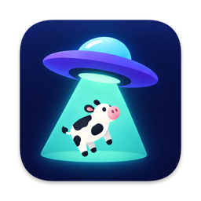
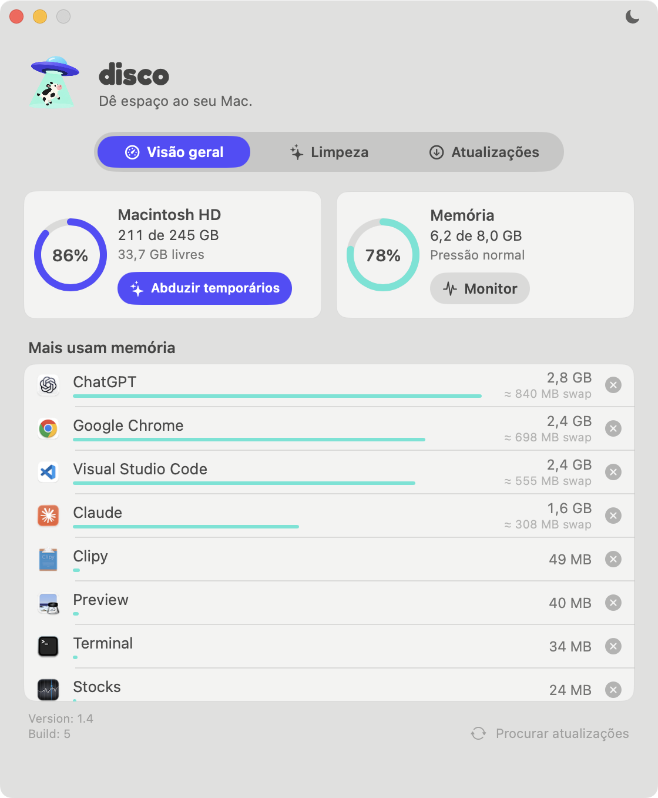
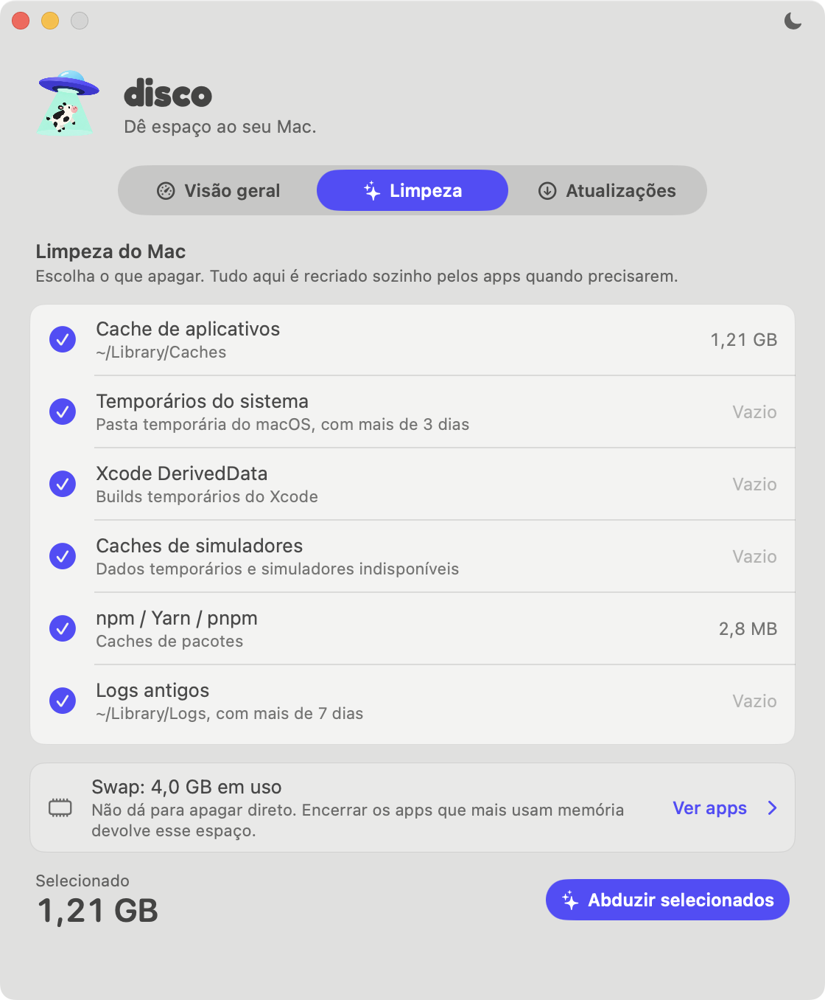
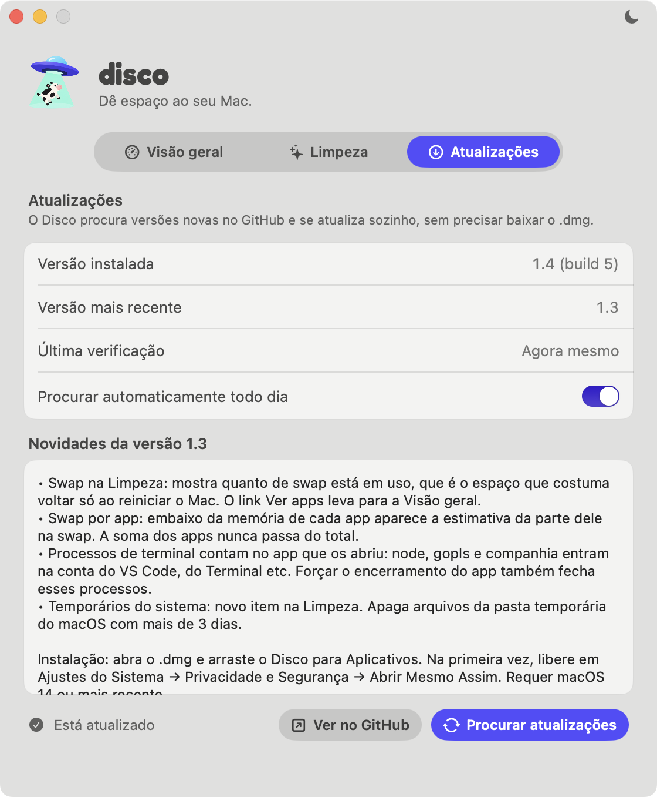
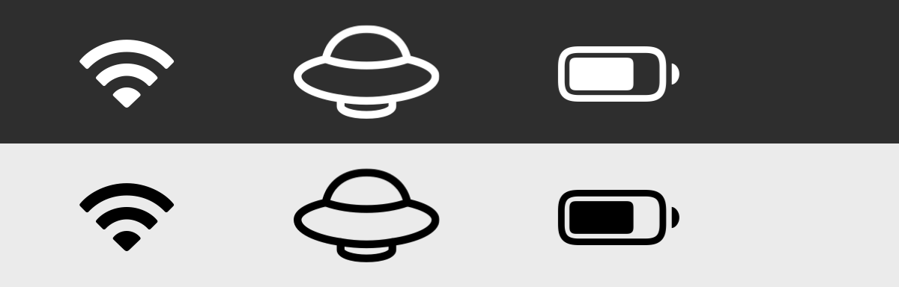
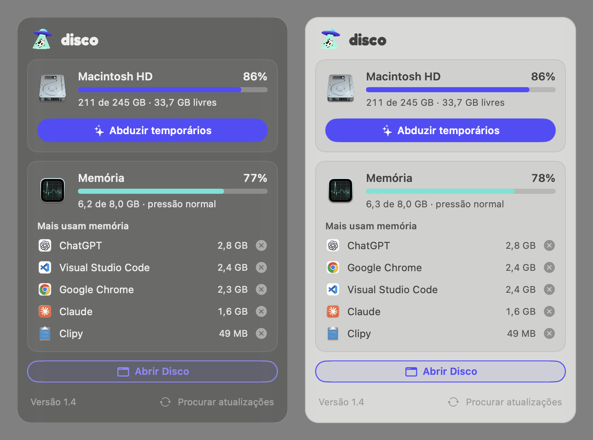
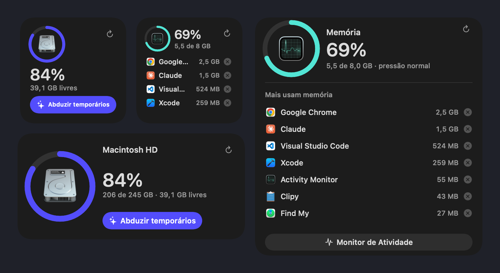

<p align="center">
  
</p>

<p align="center">
  <picture>
    <source media="(prefers-color-scheme: dark)" srcset="brand/logo-disco-branco.svg">
    
  </picture>
  <br><br>
  <picture>
    <source media="(prefers-color-scheme: dark)" srcset="brand/slogan-branco.svg">
    
  </picture>
</p>

<p align="center">
  Disco e memória do Mac na barra de menus, em widgets e numa janela no estilo do macOS.<br>
  Abduza os arquivos temporários e force o encerramento de apps pesados em um clique.
</p>

<p align="center">
  <a href="https://github.com/RogerBrusamarello/disco-macos/releases/latest"><b>⬇︎ Baixar Disco.dmg</b></a>
  &nbsp;·&nbsp; versão 1.4 &nbsp;·&nbsp; macOS 14 ou mais recente &nbsp;·&nbsp; Apple Silicon
</p>

---

## O que o disco faz

- **Mostra o uso do disco e da memória ao vivo**, na barra de menus, nos widgets e na janela.
- **Lista os apps que mais usam memória**, somando os processos auxiliares de cada um (Chrome, apps em Electron…) e o que foi aberto no terminal dele (`node`, `gopls`… contam no VS Code ou no Terminal), com quanto de cada app está na swap e um **ⓧ para forçar o encerramento**.
- **Abduz temporários:** você escolhe o que apagar entre caches, temporários do sistema, builds do Xcode, simuladores, pacotes e logs antigos, e vê o tamanho de cada item antes.
- **Respeita o visual do macOS:** modo claro e escuro, fonte do sistema, vidro translúcido e cores flat na paleta da marca.
- **Se atualiza sozinho:** procura versões novas no GitHub uma vez por dia e, com um clique, baixa, instala e reabre.
- **Fica leve:** sem ícone no Dock, abre junto com o Mac e só atualiza com frequência quando você está olhando.

## Janela

<p align="center">
  <picture>
    <source media="(prefers-color-scheme: dark)" srcset="docs/readme/janela-visao-geral-escuro.png">
    
  </picture>
</p>

Abre pelo Spotlight (`⌘ Espaço` → *Disco*), pelo Finder, clicando num widget ou em **Abrir Disco** na barra de menus.

- **Visão geral:** cartões do **Macintosh HD** e da **Memória** e a lista rolável com até 10 apps. Embaixo da memória de cada app aparece a estimativa da parte dele na swap (a partir de 50 MB). Cada app tem um ⓧ sempre visível, com a dica *Forçar encerrar*, e uma confirmação antes de fechar; encerrar também fecha os processos abertos no terminal do app.
- **Limpeza:** a lista do que pode ser abduzido (veja abaixo).
- **Atualizações:** a versão instalada, a mais recente no GitHub e as novidades (veja abaixo).
- **Tema:** o botão ☀︎/☾ no canto superior direito alterna a janela entre claro e escuro, e a escolha fica salva.
- **Rodapé:** versão e build instaladas e o link **Procurar atualizações**, que vira o botão **Atualizar para X** quando sai uma versão nova.
- Enquanto a janela está aberta, o disco aparece no Dock e no `⌘ Tab`. Ao fechar, volta a ficar só na barra de menus.

## Abduzir temporários

<p align="center">
  <picture>
    <source media="(prefers-color-scheme: dark)" srcset="docs/readme/janela-limpeza-escuro.png">
    
  </picture>
</p>

O botão **Abduzir temporários** tem o mesmo visual no widget, na barra de menus e na janela, e sempre leva para a aba **Limpeza**. Lá você marca o que quer apagar, vê o total e clica em **Abduzir selecionados**. No final aparece quanto espaço foi liberado.

| Item | O que apaga | Efeito colateral |
|---|---|---|
| **Cache de aplicativos** | `~/Library/Caches` | Os apps recriam o cache sozinhos. A primeira abertura pode ficar um pouco mais lenta. |
| **Temporários do sistema** | arquivos da pasta temporária do macOS (`$TMPDIR`, em `/var/folders/…/T`) com mais de 3 dias | Nenhum no uso normal: os apps abertos usam os arquivos recentes, que ficam. |
| **Xcode DerivedData** | `~/Library/Developer/Xcode/DerivedData` | O próximo build compila tudo do zero. |
| **Caches de simuladores** | `~/Library/Developer/CoreSimulator/Caches` e simuladores de versões do iOS que não estão mais instaladas | Os simuladores abrem um pouco mais devagar na primeira vez. |
| **npm / Yarn / pnpm** | `~/.npm/_cacache`, `~/.yarn/berry/cache`, `~/Library/pnpm/store` | O próximo `install` baixa os pacotes de novo. |
| **Logs antigos** | arquivos de `~/Library/Logs` com mais de 7 dias | Nenhum no uso normal. |

Não mexe em documentos, fotos, projetos, Lixeira, configurações nem arquivos do sistema.

### Swap

Abaixo da lista aparece quanto de **swap** está em uso: a memória que o macOS gravou no disco porque a RAM encheu. É por isso que reiniciar o Mac costuma liberar vários GB que a limpeza não libera. A swap não pode ser apagada direto (os arquivos são do sistema); ela diminui quando os apps que ocupam a memória são encerrados. **Ver apps** leva para a Visão geral, onde cada app mostra a parte dele na swap.

A parte de cada app é uma estimativa: o macOS informa quanto de cada processo foi comprimido, e o disco reparte a swap real por essa proporção, então a soma dos apps nunca passa do total.

## Atualizações

<p align="center">
  <picture>
    <source media="(prefers-color-scheme: dark)" srcset="docs/readme/janela-atualizacoes-escuro.png">
    
  </picture>
</p>

O disco procura versões novas nos [releases do GitHub](https://github.com/RogerBrusamarello/disco-macos/releases) uma vez por dia. Quando acha, o botão **Atualizar para X** aparece no painel da barra de menus, no rodapé da Visão geral e na aba **Atualizações**.

- **Aba Atualizações:** versão instalada, versão mais recente, quando foi a última verificação, a opção **Procurar automaticamente todo dia** e as novidades da versão. **Procurar atualizações** busca na hora, e **Ver no GitHub** abre a página do release.
- **Atualizar:** aparece um aviso com as novidades. Em **Atualizar e Reabrir**, o disco baixa o `.dmg`, confere se o arquivo é o mesmo publicado no GitHub (sha256) e se o app foi assinado pelo mesmo desenvolvedor, troca a versão instalada e abre de novo, já com o widget novo.
- **Sem o bloqueio do Gatekeeper:** a versão baixada pelo próprio disco não ganha a marca de quarentena, então não precisa liberar de novo em Privacidade e Segurança.
- Se o disco não tiver permissão para trocar o app (usuário sem administrador, por exemplo), ele abre o download do `.dmg` no navegador.

A atualização automática vale a partir da versão 1.4. Quem está na 1.3 ou antes atualiza uma última vez à mão.

## Barra de menus

<p align="center">
  
</p>

Na barra de menus fica só o **disco voador em contorno**, no mesmo traço dos ícones do sistema. Deixando o mouse em cima, aparecem a memória e o espaço livre. Clicando, abre o painel:

<p align="center">
  
</p>

- Segue o estilo da **Central de Controle**: vidro translúcido, cantos arredondados, sem setinha e com o conteúdo em módulos.
- **Módulo Disco:** a barra de uso e o botão **Abduzir temporários**.
- **Módulo Memória:** a barra colorida pela pressão de memória e os 5 apps que mais usam memória, cada um com ⓧ.
- **Abrir Disco** abre a janela.
- **Rodapé:** a versão instalada e **Procurar atualizações**, que vira **Atualizar para X** quando tem versão nova.
- Os números atualizam a cada 2 segundos enquanto o painel está aberto. Um clique fora fecha o painel.

## Widgets

<p align="center">
  
</p>

| Widget | Tamanho | O que mostra |
|---|---|---|
| **Disco** | pequeno | anel com o ícone do disco, % usado, GB livres e **Abduzir temporários** |
| | médio | o mesmo, com "X de Y GB" |
| **Memória** | pequeno | % usado, "X de Y GB" e os 4 apps que mais usam memória, com ⓧ |
| | médio | anel com o ícone do Monitor de Atividade e os 3 primeiros apps |
| | grande | anel, pressão de memória, os 7 primeiros apps e o botão **Monitor de Atividade** |

- **Cores:** o anel do disco é **roxo** e passa para **vermelho** acima de 90%. O da memória é **menta** e segue a pressão de memória, como o Monitor de Atividade: laranja em alerta, vermelho quando crítica.
- **↻ atualiza na hora** (e dá uma volta). Sem clicar, o macOS atualiza os widgets a cada 5–15 minutos.
- **Clicando no widget**, fora dos botões, abre a janela.

## Instalação

1. Baixe o **[Disco.dmg](https://github.com/RogerBrusamarello/disco-macos/releases/latest)**, abra e arraste o **disco** para **Aplicativos**.
2. Abra o disco. Como o app não é notarizado pela Apple, na primeira vez o macOS bloqueia a abertura. Para liberar:
   - vá em **Ajustes do Sistema → Privacidade e Segurança** e clique em **Abrir Mesmo Assim**, ou
   - rode no Terminal:
     ```bash
     xattr -dr com.apple.quarantine /Applications/Disco.app
     ```
3. O disco voador aparece na barra de menus, e o disco passa a abrir junto com o Mac.
4. **Widgets:** clique em **Editar Widgets…**, no fim da Central de Notificações, busque **Disco** ou **Memória** e arraste para a barra.

> **Atualizando de uma versão anterior?** A partir da 1.4, o próprio disco se atualiza (veja [Atualizações](#atualizações)). Se os widgets continuarem com o visual antigo, remova e adicione de novo em **Editar Widgets…**.

**Reabrir:** `⌘ Espaço` → *Disco*.
**Fechar de vez:** Monitor de Atividade → Disco → ⓧ. Para não abrir mais no login: **Ajustes do Sistema → Geral → Itens de Início**.

## Como funciona

```
┌────────────────────────────────┐        topapps.json         ┌──────────────────────────────┐
│ Disco.app  (agente, sem Dock)  │ ───── (App Group) ────────▶ │ Widgets  (sandbox)           │
│ • disco voador + painel        │                             │ • leem disco e RAM sozinhos  │
│ • janela Visão geral / Limpeza │ ◀── discowidget://clean ─── │ • mostram a lista de apps    │
│ • memória por app a cada 60 s  │ ◀── discowidget://kill ──── │ • botões abrem links         │
│ • abduz temporários / força    │ ◀── discowidget://open ──── │                              │
│   encerramento                 │                             │                              │
└────────────────────────────────┘                             └──────────────────────────────┘
```

- **Disco e RAM total:** os widgets leem direto (`URLResourceValues` e `host_statistics64`), o que o sandbox permite.
- **Apps que mais usam memória:** o sandbox dos widgets **não deixa ver outros processos**. Por isso o app disco, em segundo plano, lê a memória de cada processo a cada minuto (`proc_pid_rusage` → `phys_footprint`, o mesmo valor do Monitor de Atividade). Ele soma os processos de cada app e grava a lista num App Group que os widgets conseguem ler. Entram só os apps das pastas de Aplicativos.
- **Botões dos widgets:** os widgets também não podem apagar arquivos nem encerrar apps. Os botões abrem links `discowidget://…`, e o app faz a ação: abre a aba Limpeza, abre a janela ou pede confirmação para forçar o encerramento.
- **Atualizações:** o app lê `api.github.com/repos/RogerBrusamarello/disco-macos/releases/latest`, compara a tag (`v1.4` → `1.4`) com a versão instalada e baixa o asset `Disco.dmg`. Antes de trocar o app, confere o `sha256` que o GitHub publica para o asset e a assinatura do código (mesmo identificador e mesmo Team ID). A troca é feita no lugar, e o app e o widget são registrados de novo, como no `install.sh`.
- **Consumo:** o app fica parado quase o tempo todo. Faz uma leitura por minuto, que leva milissegundos, e só atualiza a cada 2 s enquanto o painel ou a janela estão abertos.

## Compilar

Requer Xcode 15+ e [XcodeGen](https://github.com/yonaskolb/XcodeGen) (`brew install xcodegen`).

1. Em `project.yml`, troque `DEVELOPMENT_TEAM` e `CODE_SIGN_IDENTITY` pelos seus. Uma conta Apple gratuita resolve.
2. Troque o prefixo do App Group `HM8VRSUTC3` pelo seu Team ID em `project.yml` e em `Shared/TopApps.swift`. Em `App/Updater.swift`, troque o repositório e o Team ID que a atualização confere.
3. Compile e instale:
   ```bash
   ./scripts/install.sh
   ```
   O script gera o projeto, compila, instala em `/Applications` e garante que o macOS use o widget dessa cópia (o Xcode também registra a cópia de `build/`, e o sistema pode acabar escolhendo ela).

### Publicar uma versão

O release sai do push da tag: o hook `.githooks/pre-push` gera o `Disco.dmg` e publica no GitHub. Ative o hook uma vez em cada clone:

```bash
git config core.hooksPath .githooks
```

1. Suba `MARKETING_VERSION` e `CURRENT_PROJECT_VERSION` em `project.yml` e commite.
2. Crie a tag. Com uma tag anotada, a primeira linha vira o título do release e o resto vira as notas, que também aparecem na aba Atualizações do app:
   ```bash
   git tag -a v1.5 -m "Disco 1.5 — título" -m "## Novidades

   - **Item:** o que mudou."
   ```
   Com uma tag simples (`git tag v1.5`), o título fica "Disco 1.5" e as notas listam os commits desde a tag anterior.
3. Dê push da tag:
   ```bash
   git push origin main v1.5
   ```

Antes do push, o hook confere se a tag bate com a versão do `project.yml`, compila a tag do zero numa cópia limpa (sem as mudanças não commitadas), confere a assinatura, monta o `Disco.dmg` (mesma janela, fundo e posições de sempre) e cria o release como rascunho, com o `.dmg` anexado. Se algo falhar, o push é cancelado e nada vai para o GitHub: corrija e dê o mesmo push de novo. Depois do push, em segundo plano, o release é publicado assim que a tag chega no GitHub, e aparece uma notificação. Os apps instalados (1.4 em diante) acham a versão nova em até um dia.

Para só gerar o `.dmg`, sem publicar: `./scripts/release.sh dmg v1.5` (ou `HEAD`). O arquivo fica em `build/release/Disco.dmg`. Para pular o hook num push: `git push --no-verify`.

### Estrutura

```
App/        agente: barra de menus e painel, janela (Visão geral, Limpeza e Atualizações), limpeza, leitura de processos, atualização pelo GitHub
Widget/     extensão WidgetKit: widgets Disco e Memória
Shared/     leituras de disco e RAM, paleta e botão-cápsula da marca, lista de apps compartilhada
brand/      identidade: ícone, ilustração, logo, slogan, símbolo da barra, fundo do .dmg e fontes
AGENTS.md   regras para quem mexe no projeto, pessoa ou agente (o CLAUDE.md só importa ele)
docs/       imagens deste README
scripts/    install.sh (compila e instala), release.sh (gera o .dmg e o release) e screenshots.sh (prints deste README)
.githooks/  pre-push: push de uma tag vX.Y gera e publica o release
project.yml definição do projeto (XcodeGen)
```

## Identidade

<p align="center">
  
</p>

- **Ícone e ilustração:** disco voador roxo, feixe menta e vaquinha. Os arquivos estão em [`brand/`](brand).
- **Tipografia:** o logo usa [Fredoka](https://fonts.google.com/specimen/Fredoka) Bold e o slogan usa [DM Sans](https://fonts.google.com/specimen/DM+Sans). As duas têm licença SIL Open Font License 1.1, e os arquivos e as licenças estão em `brand/fontes/`. O resto da interface usa a fonte do sistema (SF Pro), para manter o visual nativo.
- **Cores (flat):**

  | Cor | Hex | Uso |
  |---|---|---|
  | Roxo do disco voador | `#534DFC` | disco, botão Abduzir, aba ativa |
  | Menta do feixe | `#52E5D5` | memória |
  | Azul-marinho | `#070D39` | fundo do ícone |
  | Laranja / vermelho | do sistema | só como alerta |

- **Barra de menus:** `brand/menubar.svg`. O app desenha essa forma em vetor, como contorno.
