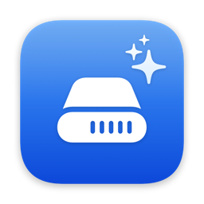
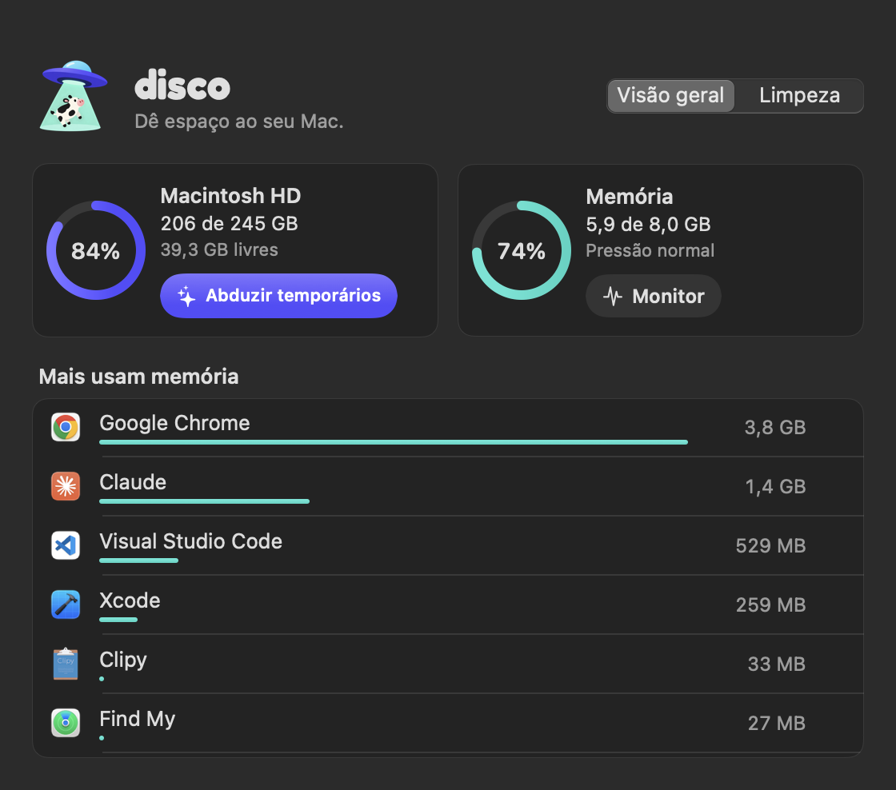
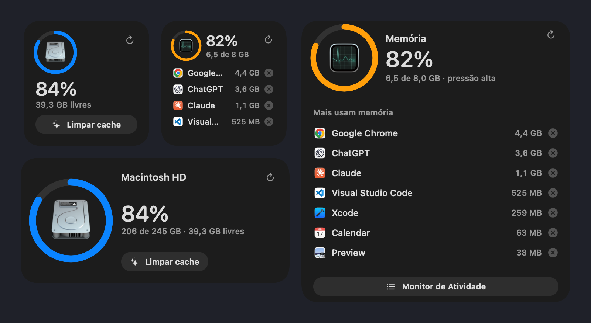
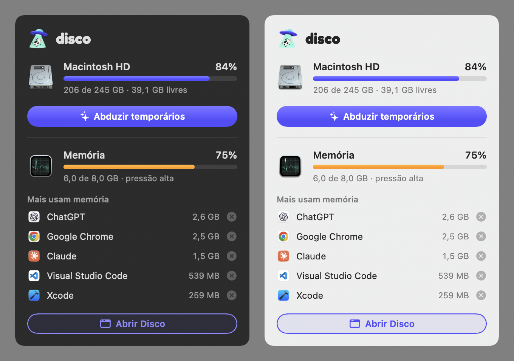
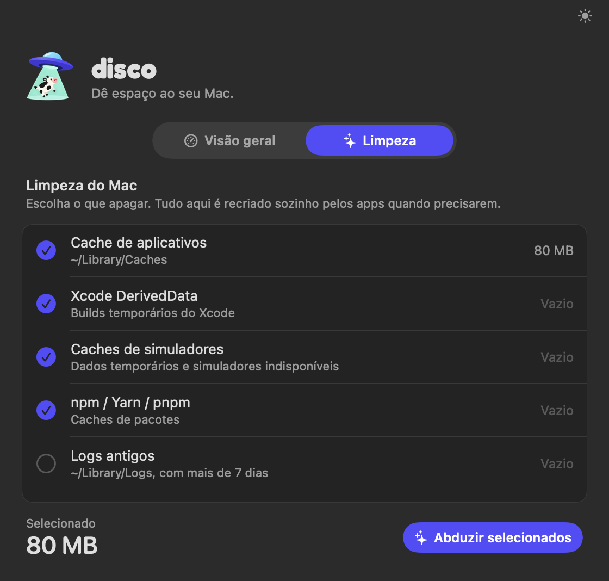

<p align="center">
  
</p>

<p align="center">
  <picture>
    <source media="(prefers-color-scheme: dark)" srcset="brand/logo-disco-branco.svg">
    
  </picture>
  <br>
  <picture>
    <source media="(prefers-color-scheme: dark)" srcset="brand/slogan-branco.svg">
    
  </picture>
</p>

<p align="center">
  Widgets e ícone na barra de menus para acompanhar <b>disco</b> e <b>memória RAM</b> do Mac,<br>
  para <b>abduzir temporários</b> e <b>forçar encerrar</b> apps em um clique.
</p>

<p align="center">
  <a href="https://github.com/RogerBrusamarello/disco-macos/releases/latest"><b>⬇︎ Baixar Disco.dmg</b></a> · macOS 14 Sonoma ou mais recente · Apple Silicon e Intel
</p>

---

## Janela

<p align="center">
  
</p>

Abrindo o **Disco** pelo Spotlight ou pelo Finder, clicando num widget ou em **Abrir Disco** no popover, aparece esta janela com tudo **ao vivo**. Enquanto ela está aberta, o app aparece no Dock. Ao fechar, ele volta a ficar só na barra de menus.

## Widgets

<p align="center">
  
</p>

| Widget | Tamanhos | O que mostra |
|---|---|---|
| **Disco** | pequeno, médio | % usado, GB livres e botão **Abduzir temporários** |
| **Memória** | pequeno, médio, grande | % usado, pressão de memória e os apps que mais consomem, cada um com **ⓧ** para forçar o encerramento |

- O anel do disco fica **azul** e passa para **vermelho** acima de 90%.
- O anel da memória segue a **pressão de memória**, igual ao Monitor de Atividade: azul (normal), laranja (alerta) e vermelho (crítica).
- O botão **↻** atualiza na hora e dá uma volta. Sem clicar, o macOS atualiza a cada 5–15 minutos.

## Barra de menus

<p align="center">
  
</p>

Na barra de menus fica só o **disco voador em contorno**, no mesmo traço dos ícones do sistema. Deixando o mouse parado em cima, aparecem a memória e o espaço livre. Clicando, abre um popover com tudo **ao vivo** (atualiza a cada 2 s enquanto está aberto):

<p align="center">
  
</p>

## Abduzir temporários

<p align="center">
  
</p>

O botão **Abduzir temporários** (igual no widget, no popover e na janela) abre a aba **Limpeza**. Lá aparecem os itens abaixo, cada um com o tamanho calculado na hora. Você marca o que quer apagar e clica em **Abduzir selecionados**.

| Item | Efeito colateral |
|---|---|
| **Cache de aplicativos** (`~/Library/Caches`) | Os apps recriam o cache sozinhos. A primeira abertura pode ficar um pouco mais lenta. |
| **Xcode DerivedData** | O próximo build do Xcode compila tudo do zero. |
| **Caches de simuladores** + simuladores indisponíveis | Os simuladores abrem um pouco mais devagar na primeira vez. Os indisponíveis são de versões do iOS que já não estão instaladas. |
| **npm / Yarn / pnpm** (`~/.npm/_cacache`, `~/.yarn/berry/cache`, `~/Library/pnpm/store`) | O próximo `install` baixa os pacotes de novo. |
| **Logs antigos** (`~/Library/Logs`, com mais de 7 dias) | Nenhum no uso normal. |

Não mexe em documentos, fotos, projetos, Lixeira, configurações nem arquivos do sistema.

## Instalação

1. Baixe o **[Disco.dmg](https://github.com/RogerBrusamarello/disco-macos/releases/latest)** e arraste o **Disco** para **Aplicativos**.
2. Abra o Disco. Como o app não é notarizado pela Apple, na primeira vez o macOS bloqueia a abertura:
   - vá em **Ajustes do Sistema → Privacidade e Segurança** e clique em **Abrir Mesmo Assim**, ou
   - rode no Terminal:
     ```bash
     xattr -dr com.apple.quarantine /Applications/Disco.app
     ```
3. O ícone aparece na barra de menus, e o Disco passa a abrir junto com o Mac (item de login).
4. Para adicionar os widgets: clique em **Editar Widgets…**, no fim da Central de Notificações, busque **Disco** ou **Memória** e arraste para a barra.

**Reabrir:** ⌘ Espaço → `Disco`.
**Fechar de vez:** Monitor de Atividade → Disco → ⓧ. Para não abrir mais no login: **Ajustes → Geral → Itens de Início**.

## Como funciona

```
┌──────────────────────────────┐        topapps.json         ┌───────────────────────────┐
│  Disco.app (agente, sem Dock)│ ──── (App Group) ─────────▶ │ Widget (sandbox)          │
│  • ícone + popover na barra  │                             │ • lê disco e RAM sozinho  │
│  • lê memória por app (60 s) │ ◀── discowidget://clean ─── │ • mostra lista de apps    │
│  • abduz temporários / quit  │ ◀── discowidget://kill ──── │ • botões abrem links      │
└──────────────────────────────┘                             └───────────────────────────┘
```

- **Disco e RAM total:** o widget lê direto (`URLResourceValues` e `host_statistics64`). Isso é permitido dentro do sandbox.
- **Apps que mais usam memória:** o sandbox dos widgets **não deixa ver outros processos**. Por isso o app Disco, que roda em segundo plano, lê a memória de cada processo a cada minuto (`proc_pid_rusage` → `phys_footprint`, o mesmo valor que o Monitor de Atividade mostra). Ele soma os processos auxiliares de cada app (Chrome, Electron…) e grava a lista num App Group que o widget consegue ler.
- **Botões do widget:** o widget também não pode apagar arquivos nem encerrar apps. Os botões abrem links `discowidget://…`, e o app Disco abre a aba Limpeza ou pede confirmação para forçar o encerramento.
- **Consumo:** o app fica parado quase o tempo todo. Ele faz uma leitura por minuto, que leva milissegundos, uma a cada 2 s só enquanto o popover está aberto.

### Estrutura

```
App/       agente da barra de menus: popover, limpeza, forçar encerramento, leitura de processos
Widget/    extensão WidgetKit: widgets Disco e Memória
Shared/    leituras de disco/RAM, formatação e a lista de apps compartilhada
brand/     identidade: ícone, ilustração, logo, slogan, símbolo da barra, fundo do .dmg e fontes
project.yml  definição do projeto (XcodeGen)
```

## Compilar

Requer Xcode 15+ e [XcodeGen](https://github.com/yonaskolb/XcodeGen) (`brew install xcodegen`).

1. Em `project.yml`, troque `DEVELOPMENT_TEAM` e `CODE_SIGN_IDENTITY` pelos seus (uma conta Apple gratuita resolve).
2. Troque o prefixo do App Group `HM8VRSUTC3` pelo seu Team ID em `project.yml` e em `Shared/TopApps.swift`.
3. Gere o projeto e compile:
   ```bash
   xcodegen generate
   xcodebuild -project Disco.xcodeproj -scheme Disco -configuration Release -derivedDataPath build build
   cp -R build/Build/Products/Release/Disco.app /Applications/
   ```
   Ou use `./scripts/install.sh`, que faz tudo isso e garante que o macOS use o widget de `/Applications` (o Xcode também registra a cópia de `build/`).

## Identidade

Todos os arquivos estão em [`brand/`](brand):

- **Ícone e ilustração:** disco voador roxo, feixe verde-menta e vaquinha, em PNG 1024 px.
- **Logo:** [Fredoka](https://fonts.google.com/specimen/Fredoka) Bold. **Slogan:** [DM Sans](https://fonts.google.com/specimen/DM+Sans) Regular. As duas fontes têm licença SIL Open Font License 1.1, e os arquivos e as licenças estão em `brand/fontes/`.
- **Barra de menus:** `menubar.svg`. O app desenha essa forma em vetor, como contorno.
- **Cores dos widgets:** roxo do disco voador `#534DFC` para o disco, menta do feixe `#52E5D5` para a memória, e laranja/vermelho só como alerta.
- **Interface:** widgets e popover usam a fonte do sistema (SF Pro), para manter o visual nativo do macOS.
